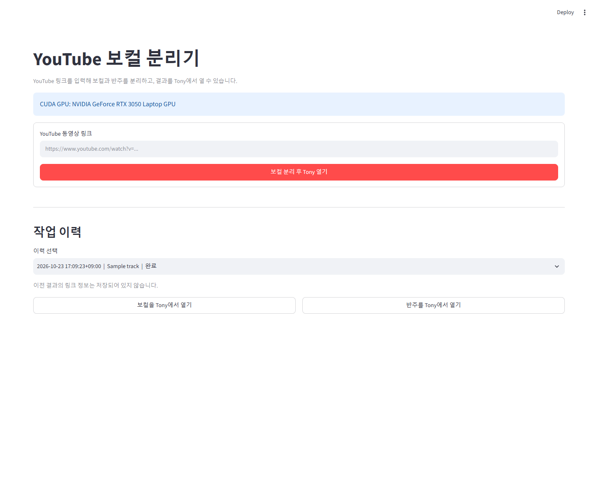
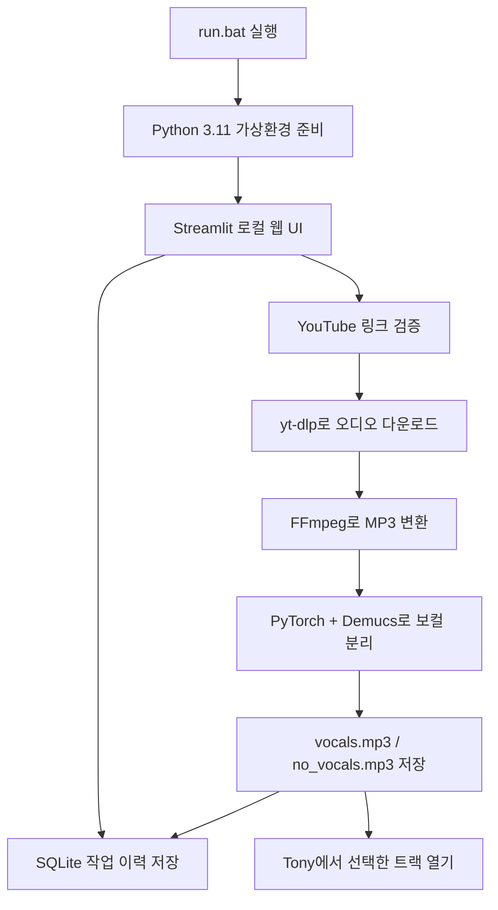

# YouTube 보컬 분리기

[English](./README.md) | 한국어

YouTube 동영상에서 오디오를 다운로드하고 Demucs로 보컬과 반주를 분리한 뒤, 결과를 Tony 비주얼라이저에서 열어 주는 Windows 앱입니다. NVIDIA GPU, 특히 VRAM이 적은 환경을 고려해 설정되어 있습니다.

## 주요 기능

- 브라우저 UI에서 YouTube 동영상 링크를 입력해 보컬과 반주를 분리합니다.
- 분리가 완료되면 보컬 트랙을 Tony에서 자동으로 엽니다.
- 작업 이력에 원본 링크와 생성된 파일을 저장합니다.
- 이전 이력을 선택해 보컬 또는 반주를 Tony에서 다시 열 수 있습니다.
- NVIDIA GPU가 없으면 CPU 모드로 실행합니다.

## 요구 사항

- Windows 10 또는 11
- Python 3.11
- 오디오 변환을 위한 FFmpeg 설치 및 `PATH` 등록
- NVIDIA GPU를 사용하는 경우 CUDA 12.8을 지원하는 드라이버
- Tony 비주얼라이저 (선택 사항)

Tony는 기본적으로 `C:\Program Files\Tony\tony.exe`에서 찾습니다. 다른 경로에 설치한 경우 `TONY_EXE` 환경 변수에 `tony.exe`의 전체 경로를 지정하세요. Tony가 없어도 오디오 분리와 파일 저장은 가능합니다.

## 설치 및 실행

1. Python 3.11과 FFmpeg를 설치합니다. FFmpeg가 준비되었는지 확인하려면 명령 프롬프트에서 다음을 실행하세요.

   ```bat
   ffmpeg -version
   ```

2. 저장소를 내려받습니다.

   ```bat
   git clone https://github.com/Devleu0/yt2tony.git
   cd yt2tony
   ```

3. `run.bat`을 실행합니다. 최초 실행 시 프로젝트 폴더에 `.venv` 가상환경을 만들고 PyTorch와 필요한 패키지를 설치한 다음 브라우저 UI를 시작합니다. 이후 실행부터는 기존 환경을 재사용합니다.

   ```bat
   run.bat
   ```

4. 브라우저가 자동으로 열립니다. 열리지 않으면 명령 프롬프트에 표시된 주소를 확인하거나 기본 주소 `http://localhost:8501`에 접속하세요. 실행 중에는 명령 프롬프트 창을 닫지 마세요. 앱을 종료하려면 해당 창에서 `Ctrl+C`를 누릅니다.

   이 웹 페이지는 **내 PC에서 실행되는 로컬 UI**입니다. GitHub에 저장소를 공개해도 앱이 인터넷에 배포되거나 다른 사람에게 공개되는 것은 아닙니다. 기본 설정은 현재 PC에서만 접속할 수 있습니다.

## 사용 방법

1. YouTube 동영상 링크를 입력합니다.
2. Enter 키를 누르거나 **보컬 분리 후 Tony 열기** 버튼을 선택합니다.
3. 다운로드와 분리가 끝나면 보컬 트랙이 Tony에서 자동으로 열립니다.
4. **작업 이력**에서 이전 작업을 선택하고 **보컬을 Tony에서 열기** 또는 **반주를 Tony에서 열기**를 선택하면 해당 파일을 다시 열 수 있습니다.

새 작업마다 별도의 결과 폴더를 사용하므로 이전 결과를 덮어쓰지 않습니다. 최초 실행 시 기존 `output/htdemucs/input_track/` 결과가 있으면 링크 정보가 없는 이력 항목으로 가져옵니다.

## 화면 미리보기



## 파이프라인 구조



1. **시작**: `run.bat`이 저장소 위치를 기준으로 `.venv`를 만들고 실행에 필요한 패키지를 설치한 다음 Streamlit을 시작합니다.
2. **다운로드**: UI에서 받은 링크를 검증한 후 `yt-dlp`가 재생목록이 아닌 단일 영상의 오디오를 임시 MP3 파일로 저장합니다.
3. **분리**: PyTorch가 사용 가능한 NVIDIA CUDA GPU를 선택하고, 없으면 CPU를 선택합니다. Demucs는 `--two-stems vocals`와 `--segment 2` 옵션으로 보컬과 반주를 분리합니다.
4. **저장 및 실행**: 결과는 작업별 폴더에 저장되고 작업 이력은 SQLite에 기록됩니다. 새 작업은 보컬을 Tony에서 자동으로 열며, 이력에서는 보컬 또는 반주 중 원하는 트랙을 다시 열 수 있습니다.

웹 UI와 이력 데이터베이스는 같은 PC에서 동작합니다. 따라서 Tony 실행과 파일 경로도 웹 브라우저가 열린 PC를 기준으로 합니다.

## 의존성

| 구성 요소 | 종류 | 역할 |
| --- | --- | --- |
| Python 3.11 | 런타임 | 앱과 처리 파이프라인 실행 |
| Streamlit | Python 패키지 | 로컬 웹 UI와 작업 이력 화면 |
| yt-dlp | Python 패키지 | YouTube 동영상 정보 및 오디오 다운로드 |
| Demucs | Python 패키지 | 보컬과 반주 분리 |
| PyTorch | Python 패키지 | Demucs 추론 및 CUDA GPU 사용 |
| TorchAudio | Python 패키지 | PyTorch 오디오 처리 연동 |
| NumPy | Python 패키지 | 오디오·수치 데이터 처리 |
| FFmpeg | 외부 프로그램 | 다운로드된 오디오를 MP3로 변환 |
| SQLite (`sqlite3`) | Python 표준 라이브러리 | URL, 상태, 결과 파일 경로를 로컬 데이터베이스에 저장 |
| Tony | 외부 프로그램, 선택 사항 | 분리한 보컬 또는 반주를 열어 시각화 |

Python 패키지는 `requirements.txt`에서 설치하고, PyTorch와 TorchAudio는 `run.bat`에서 CUDA 12.8용 공식 휠 저장소를 지정해 설치합니다. Demucs에 필요한 추가 Python 패키지는 패키지 관리자가 함께 설치합니다. YouTube 형식 지원 정책이 바뀌면 `yt-dlp` 버전을 갱신해야 할 수 있으며, 로그에 JavaScript 런타임 경고가 표시될 수 있습니다.

## 결과 파일과 이력

```text
output/
├── history.sqlite3
└── htdemucs/
    └── <작업 ID>/
        ├── vocals.mp3
        └── no_vocals.mp3
```

- `vocals.mp3`: 분리된 보컬
- `no_vocals.mp3`: 보컬을 제거한 반주
- `history.sqlite3`: 처리한 링크, 작업 상태, 결과 파일 경로

다운로드한 오디오와 분리 결과는 로컬 프로젝트 폴더에 저장됩니다. `.venv/`, `output/`, `temp/`는 Git에서 제외됩니다.

## 문제 해결

- **FFmpeg를 찾을 수 없음**: FFmpeg의 `bin` 폴더가 시스템 `PATH`에 등록되어 있는지 확인하고, 새 명령 프롬프트에서 `ffmpeg -version`을 실행합니다.
- **GPU 메모리 부족(OOM)**: 다른 GPU 사용 프로그램을 닫은 뒤 다시 시도하세요. 분리 단계는 낮은 VRAM 사용량을 위해 Demucs `--segment 2` 옵션을 사용합니다.
- **Tony를 찾을 수 없음**: Tony 설치 경로를 확인하고 `TONY_EXE` 환경 변수를 지정하세요. 분리된 결과는 UI의 작업 이력에서도 다시 열 수 있습니다.
- **GPU를 사용할 수 없음**: NVIDIA 드라이버가 CUDA 12.8 지원 버전인지 확인하세요. GPU가 인식되지 않으면 CPU 모드로 실행됩니다.

## 라이선스

이 프로젝트는 GNU General Public License v3.0 전용(GPL-3.0-only)입니다. 자세한 조건은 [LICENSE](./LICENSE)를 확인하세요.
