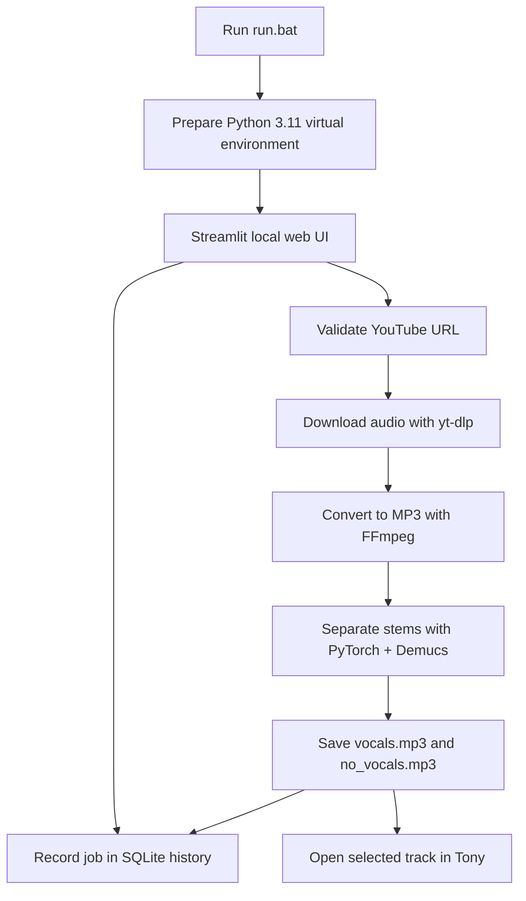

# Youtube Vocal Splitter

[한국어](./README.ko.md) | English

A pipeline tool that downloads YouTube audio, isolates vocals using Demucs, and automatically loads the result into the Tony visualizer. Optimized for NVIDIA GPUs with low VRAM (e.g., RTX 3050 4GB).

## System Requirements

- **OS**: Windows 10/11
- **Python**: 3.11
- **GPU**: NVIDIA GPU (CUDA 12.8 compatible driver)
- **External Dependencies**:
  - **FFmpeg**: Must be installed and added to the system `PATH`.
  - **Tony**: Melody transcription software. Installed at `C:\Program Files\Tony\tony.exe`. ([Download Tony](https://code.soundsoftware.ac.uk/projects/tony))

## Installation

1. Clone the repository:
   ```bash
   git clone https://github.com/Devleu0/yt2tony.git
   cd yt2tony
   ```

2. Install Python 3.11 and FFmpeg. Tony is optional and can be installed separately.

3. Run `run.bat` from File Explorer or a command prompt. On its first run, it creates a local `.venv`, installs CUDA-enabled PyTorch and the project dependencies, then opens the browser-based interface. Later runs reuse the environment.

   The setup uses PyTorch's CUDA 12.8 wheels; a compatible NVIDIA driver is required. If no supported NVIDIA GPU is available, the program falls back to CPU.

4. The browser opens automatically. If it does not, use the address printed in the command prompt, or open the default URL `http://localhost:8501`. Keep the command prompt open while using the app; press `Ctrl+C` in that window to stop it.

   This is a **local web UI**, not a website deployed to the internet. Making the GitHub repository public does not publish or host the running app. By default, only this PC can connect.

Verify FFmpeg is available:
```bash
ffmpeg -version
```

## Usage

Enter a YouTube video URL and press Enter or select **보컬 분리 후 Tony 열기**. Once separation finishes, the vocal track opens in Tony automatically. The history list keeps each link and its vocal/instrumental results; select an earlier item to open either track in Tony again. The existing result is also added to the history, but its original link was not recorded.

Each run saves separate files under `output/htdemucs/<run-id>/`, and the history database is stored in `output/history.sqlite3`. Tony is optional; if it is not installed at `C:\Program Files\Tony\tony.exe`, set the `TONY_EXE` environment variable to its executable path.

## Web UI Preview


## Pipeline



1. `run.bat` creates/reuses `.venv`, installs packages, then starts Streamlit.
2. `yt-dlp` downloads audio for one video to a temporary MP3 file.
3. Demucs separates vocals and instrumental using CUDA when available, or CPU otherwise. `--segment 2` limits memory usage.
4. Both tracks are saved under a unique run folder. SQLite records the URL, status, and file paths. New jobs open vocals in Tony; history lets you open either stem again.

The UI, database, output files, and Tony run on the same PC. The file paths and Tony launch are local to that host.

## Dependencies

| Component | Type | Purpose |
| --- | --- | --- |
| Python 3.11 | Runtime | Runs the app and processing pipeline |
| Streamlit | Python package | Local web UI and job history |
| yt-dlp | Python package | Retrieves YouTube metadata and downloads audio |
| Demucs | Python package | Separates vocals and instrumental |
| PyTorch | Python package | Demucs inference and CUDA acceleration |
| TorchAudio | Python package | Audio processing integration for PyTorch |
| NumPy | Python package | Audio and numerical data processing |
| FFmpeg | External program | Converts downloaded audio to MP3 |
| SQLite (`sqlite3`) | Python standard library | Stores URLs, job status, and output paths locally |
| Tony | Optional external program | Opens and visualizes either separated track |

Python packages are declared in `requirements.txt`. `run.bat` installs PyTorch and TorchAudio from the official CUDA 12.8 wheel index; Demucs' additional Python dependencies are installed automatically. YouTube format support may require updating `yt-dlp` as YouTube changes; it may also print a warning about a JavaScript runtime.

## License

This project is licensed under the GNU General Public License v3.0 only. See [LICENSE](./LICENSE) for the full terms.

## Architecture & Optimization

- **Audio Format**: Uses MP3 encoding instead of WAV to reduce disk I/O bottlenecks and storage requirements.
- **VRAM Constraint Management**: The Demucs parameter `--segment 2` is hardcoded to prevent Out of Memory (OOM) exceptions on 4GB VRAM environments.
- **Playlist Handling**: Hardcoded `--no-playlist` flag in `yt-dlp` prevents unintended batch downloads.

## Directory Structure

Upon successful execution, output files are stored as follows:
```text
output/
├── history.sqlite3
└── htdemucs/
    └── <run-id>/
        ├── vocals.mp3
        └── no_vocals.mp3
```

## Troubleshooting

- **OOM (Out of Memory) Error during Demucs execution**: Ensure no other VRAM-heavy applications (e.g., games, 3D software) are running in the background.
- **FFmpeg not found**: Ensure the `bin` folder of your FFmpeg installation is explicitly added to the Windows environment variables (`PATH`).